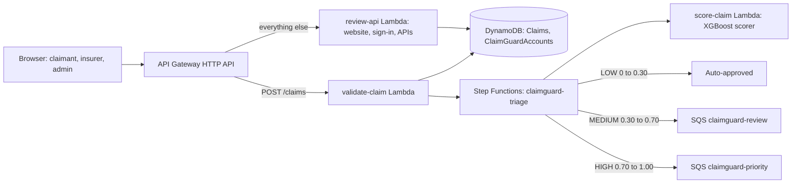

# ClaimGuard

**Healthcare claims fraud triage on AWS.** ClaimGuard scores every insurance claim in under a second, auto-approves the safe ones and sends the risky ones to a human reviewer, so fraud is caught without delaying honest patients.

Built for a hackathon on the AWS Learner Lab (us-east-1, $50 budget).

> **Simulated data.** All claims, accounts and the benchmark below are synthetic. On the simulated test set the model caught **91.0%** of fraud and delayed **0.3%** of legitimate claims. These are benchmark figures, not real-world results.

## The problem

Insurers lose money to fraudulent claims (a fever billed as heart surgery, the same bill sent twice, a hospital billing far above its peers). Reviewers cannot read every claim, and slowing down every claim punishes honest patients. ClaimGuard scores each claim automatically and routes only the suspicious ones to people.

## How it works



1. A claimant submits a claim from the website.
2. `validate-claim` checks it, builds the model inputs from the patient's and hospital's history, stores it and starts a Step Functions run.
3. `score-claim` returns a risk score from 0 to 1, and the workflow routes the claim:
   - **0 to 0.30 (LOW):** auto-approved.
   - **0.30 to 0.70 (MEDIUM):** manual verification.
   - **0.70 to 1.00 (HIGH):** priority review.
4. Insurers work the two review lists in the website. Their decisions are written back to the Claims table.

## The model

An XGBoost classifier on 11 inputs: `amount_ratio`, `expected_cost`, `procedure_mismatch`, `days_since_previous_claim`, `patient_claims_30d`, `provider_claims_30d`, `provider_avg_amount`, `provider_patient_count`, `duplicate_candidate`, `same_day_patient_provider_count`, `same_day_provider_claim_count`.

- Trained on a synthetic claims generator, with leakage fixes (30-day window counts instead of raw day and amount features).
- Scored inside Lambda by a dependency-free pure-Python scorer, parity-tested against XGBoost.
- 16 documented criteria (F1 to F9 for fraud signals, L1 to L7 for legitimate patterns) are shown in the website; a few are marked planned.

## The website: three roles

| Role | What they can do |
| --- | --- |
| **Claimant** | Sign in, see profile and policy, submit claims (with presets such as "Normal visit" and "Fever billed as heart surgery"), see a safe status. Never sees scores, notes or reviewers. |
| **Insurer** | Work the Medium, High and Verification lists; open a case with risk meter, model inputs, plain-English "why flagged" box and rules check; Approve, Reject, Escalate or request Manual verification through confirmation pop-ups. Approval limits apply per insurer. |
| **Admin** | Overview charts, live health of eight AWS components, user accounts (suspend or reactivate claimants), rules and model facts, a fraud-network graph, and **Attack mode**, which launches a simulated fraud ring against the real model and clears it afterwards. |

The site is plain JavaScript with no framework. Text is inserted with `textContent`, never `innerHTML`.

## AWS services used

| Service | Role in ClaimGuard |
| --- | --- |
| Lambda (python3.12) | `validate-claim`, `score-claim` and `review-api` (serves the site and all APIs) |
| API Gateway (HTTP API) | Public entry: `POST /claims` to validate-claim, everything else to review-api |
| DynamoDB | `Claims` (about 50,000 items, with patient, provider and sparse review-queue indexes) and `ClaimGuardAccounts` (about 507 items) |
| Step Functions | `claimguard-triage` workflow that scores and routes each claim |
| SQS | `claimguard-review` and `claimguard-priority` waiting lists |
| S3 | Project storage |
| CloudWatch | Logs and the metrics behind the admin health tab |

## Security

- Demo sign-in with HMAC-signed tokens (user id, role, 8-hour expiry). The role comes from the account type.
- The admin role needs a passcode stored only in the `review-api` Lambda's environment. It is never in this repository.
- With `ENFORCE_AUTH=true`: no token gives 401, the wrong role gives 403, only insurers can decide claims, approvals above an insurer's limit give 403 and a second decision on a claim gives 409.

**This is demo authentication, not production identity management.** A real deployment would use Cognito or the insurer's identity provider.

## Repository layout

| Folder | Contents |
| --- | --- |
| `ml/` | Synthetic data generator, feature code and XGBoost training |
| `lambdas/` | The Lambda functions (`review_api/` holds the site's backend: `handler.py`, `portal.py`, `admin.py`) |
| `dashboard/` | The website: `index.html` and `static/` scripts and styles |
| `infra/` | Deployment scripts and live test scripts |
| `deploy/` | Dockerfile, Kubernetes manifests and run scripts |

## Run it

Everything needs the Learner Lab running and fresh AWS credentials in `~/.aws/credentials` (they expire after a few hours). Check with `aws sts get-caller-identity`.

**On AWS (the main deployment)**

```bash
python infra/deploy_review_api.py
```

The website is served at the root of the API Gateway URL (the `API_URL` in `.env`, without `/claims`).

**In Docker**

```bash
bash deploy/docker_run.sh        # http://localhost:18080
```

**On Kubernetes (minikube, kind or Docker Desktop)**

```bash
minikube start --driver=docker
bash deploy/k8s_up.sh
kubectl -n claimguard port-forward svc/claimguard-web 18081:80   # http://localhost:18081
```

The container wraps the unchanged Lambda handler in a small web server (`deploy/server.py`), so the containerised site behaves exactly like the Lambda. It still reads and writes the real AWS services. Re-run the scripts to refresh expired credentials.

## Demo accounts

| Role | Account ids |
| --- | --- |
| Claimant | `PT00100` to `PT00199` |
| Insurer | `INS-001` to `INS-004` (approval limits from ₹50,000 up to ₹50 lakh) |
| Admin | `ADM-001` (needs the admin passcode) |

Read the admin passcode from your own AWS account (do not commit it):

```bash
aws lambda get-function-configuration --function-name review-api --region us-east-1 \
  --query "Environment.Variables.ADMIN_PASSCODE" --output text
```

## Tests

Live tests run real sign-ins and real claims against the deployed system and print PASS or FAIL per check:

```bash
python infra/test_claimant_flow.py
python infra/test_insurer_flow.py
python infra/test_admin_flow.py
python infra/test_attack_flow.py
```

Measured on the deployed system: 26 of 26 workflow runs succeeded, about 0.8 s average triage time and about 86 ms review-api latency.

## Known limitations

- All data and the benchmark are simulated.
- Sign-in is demo-grade, as described above.
- The model catches repeated duplicate bills but can miss the first copy, so humans stay in the loop. In attack mode it flagged 7 to 8 of 9 simulated ring claims.
- Routing thresholds (0.30 and 0.70) are shown read-only in the website.
- The "rule fired" markers in the case view read the rule text, so ambiguous rules show "Value shown" instead.
- Test and attack claims write to the real tables (attack claims are deleted when cleared).
- No encryption review, audit retention or compliance work (for example HIPAA) has been done; it is roadmap.

## Roadmap

Athena and a CloudWatch dashboard for analytics, infrastructure as code (Terraform) and a CI pipeline (GitHub Actions), a production identity provider, and a compliance review.
